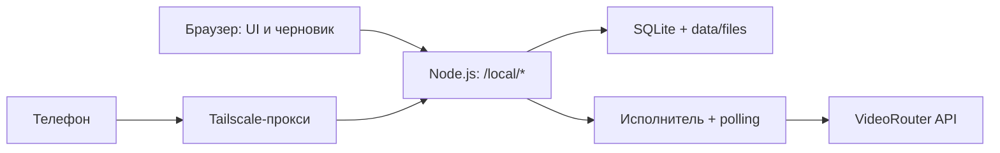

# Текущее состояние и аудит

> Исторический аудит **до реализации**. Описанные здесь потери черновиков, отсутствие image-связей и прочие статусы относятся к исходной версии. Актуальное состояние и остаточные ограничения — в [09](09-current-state-and-next-thread.md).

Дата: 2026-11-17. Это снимок состояния, не описание будущей реализации.

## Вывод

VideoRouterAPI UI пригоден для отдельных генераций и простых последовательных workflow, если пользователь понимает API и вручную контролирует параметры. Главные препятствия повседневной работе: потеря черновиков, слабая воспроизводимость запусков, различия между оценкой цены и фактической конфигурацией, длинные формы и неудобная работа с результатами.

## Источники и метод проверки

- **UI** — непосредственное исследование текущего приложения в браузере на изолированной копии, включая ширину 390 px.
- **Код** — исходники и локальные проверки функций без сети.
- **БД** — сохранённые workflow, каталог моделей и история; свидетельство прошлой работы, не новый end-to-end тест API.
- **История** — контекст переписки, отдельно перечисленный ниже.
- **Риск/предположение** — следствие наблюдаемой реализации, не воспроизведённый внешний сбой.

На порту 8791 исходный сервер во время аудита не работал. Копия приложения с копией SQLite запускалась на 127.0.0.1:18791 без API/management keys. Содержимое медиофайлов в копию не переносилось: нельзя оценивать работоспособность сохранённых файлов и автоматическое определение длительности по их отсутствию в этой среде.

Исследованы обзор, редактор workflow, расширенные параметры, открытие сохранённых workflow, оценка стоимости, бюджетный подбор, каталог моделей, история и экран ошибки. Мобильная проверка — эмуляция ширины браузера, не реальный телефон.

Платные API-запросы, внешние загрузки и установка зависимостей не выполнялись. Временный сервер остановлен. Контрольные суммы восьми исходных файлов совпали до и после аудита. Оригинальные исходники и конфигурация не менялись.

## Назначение и пользовательские сценарии

Локальная персональная студия для VideoRouter: изучить модели/API, подготовить медиа, собрать последовательность запросов, оценить цену, запустить и изучить результаты.

Основные сценарии:

1. Подключить ключ → выбрать действие/модель → заполнить параметры → подготовить и подтвердить запрос.
2. Создать workflow → указать файл/URL/результат предыдущего шага → сохранить → запустить последовательность.
3. Оценить шаг или подобрать модели под диапазон бюджета → применить изменения к черновику.
4. Открыть историю → изучить статус, ответ, ошибку и учтённую стоимость.
5. Работать с телефона через отдельный Tailscale-прокси.

## Архитектурная карта



| Компонент | Ответственность |
|---|---|
| [public/app.js](../public/app.js) | Vanilla JS SPA: навигация, формы, состояние в памяти, правила моделей, компиляция workflow, оценка цены и бюджетный подбор. Перерисовка через `innerHTML`. |
| [public/index.html](../public/index.html), [style.css](../public/style.css) | Оболочка и адаптивные стили. |
| [public/catalog.json](../public/catalog.json) | Статический снимок: 73 операции, 750 публичных записей моделей, 60 ссылок на руководства. Не автоматически актуальная схема API. |
| [server.mjs](../server.mjs) | HTTP-сервер на localhost, ключи, файлы, SQLite, подготовка и запуск, опрос заданий, история и кеш аккаунта/моделей. |
| [engine.mjs](../engine.mjs) | Запросы JSON/multipart/query, обработка бинарных/SSE/обычных ответов, ссылки на предыдущие результаты. |
| `data/studio.sqlite`, `data/files/` | Workflow, запуски, кеши, метаданные файлов; файлы отдельно по UUID. |
| [tailscale.mjs](../tailscale.mjs) | Отдельный прокси для заданных Tailscale IPv4 Mac/телефона, без управления жизненным циклом сервера. |

Исходящий API: `https://videorouter.sh/api`. Обычный ключ отделён от management key. Есть техническая Realtime-консоль. Ключи хранятся в памяти сервера или приходят из окружения; предусмотрены Host/Origin-проверки, CSP и одноразовый ticket подготовленной конфигурации. Полный аудит безопасности не выполнялся.

Исполнение: frontend компилирует пользовательские шаги, добавляя загрузки и встроенную озвучку → `/local/prepare` проверяет конфигурацию и ключи → ticket живёт 120 секунд → `/local/run` запускает последовательное исполнение → асинхронные задания опрашиваются → результаты сохраняются. Связи используют позиционные ссылки вида `{{1.data.0.url}}`.

## Состояние реализации

| Возможность | Статус и предел проверки |
|---|---|
| Обзор | Работает; кешированный баланс, число операций, workflow и запусков. Недостаточно ориентирован на продолжение текущей работы. |
| API Explorer | Формы по каталогу, JSON, расширенные параметры. Наличие операции не доказывает успешную интеграцию всех её вариантов. |
| Каталог моделей | Поиск, фильтры, цена, единица тарифа, сортировка, обновление. Отображение/сортировка кеша проверены; обновление не запускалось. |
| Удобные шаги | Видео, TTS, lip-sync, транскрипция, upload. Изображения доступны через общий API-редактор, без равнозначного удобного шага. |
| Источники медиа | Файл, URL, результат предыдущего шага; встроенная озвучка для части аудиовходов. |
| Связи шагов | Частичная поддержка. `sourceChoices()` знает TTS/file, upload/url, видео и lip-sync при ожидании результата. Не предлагает выход `POST /v1/images`. |
| Размеры/модели | Есть зависимые поля, поиск видеомоделей, ограничения. Правила смешивают каталог, тарифы и ручные исключения. |
| Последовательное исполнение | Реализовано, включая автоматические технические шаги и polling. Непрерывное выполнение с платным API не проверялось. |
| Оценка шага | Реализована через pricing/estimate; ожидаемая/верхняя цена и детали. Проверены UI и локальная валидация, без внешнего расчёта. |
| Оптимизация бюджета | Реализована для поддерживаемых видео/lip-sync шагов, с фиксированными расходами других шагов. Ограниченный подбор, не глобальный оптимум. |
| Сохранение | Ручное сохранение/открытие. Автосохранения черновика нет. |
| История | Статусы, ответы, ошибки, стоимость, JSON. Полная исходная конфигурация запуска не сохраняется. |
| Tailscale | Код прокси есть; соединение с настоящего телефона не проверялось. |
| Realtime | Техническая консоль событий; соединение с сервисом не проверялось. |

В БД на момент проверки: 5 workflow, 78 запусков, 17 записей файлов; 72 записи completed, 6 failed. В числе операций есть 32 завершённые оценки, 25 загрузок, 15 завершённых видеозапросов и один завершённый lip-sync. Это не 78 генераций. Кеш API от 16 ноября содержит 1272 записи моделей; lip-sync — 26, тогда как ручной список удобного редактора содержит 16.

Не обнаружены: If/Else, пауза для решения пользователя, resume после остановки сервера, циклы/параллельное исполнение, полноценный webhook-приёмник с проверкой подписи, гарантированный лимит расходов при запуске, автоматическая проверка разрешения готового видео.

## Проблемы

P1 — риск потери работы, невоспроизводимости или неверного ожидания расходов. P2 — препятствие повседневной работе.

| ID | Приоритет | Проблема и эффект | Компоненты / доказательство |
|---|---|---|---|
| A01 | P1 | Черновик теряется после reload без предупреждения. Введённый текст исчез, Workflow открылся пустым. | `flow`, инициализация, сохранение; UI + код. |
| A02 | P1 | В запуске нет полной исходной конфигурации. Нельзя надёжно восстановить запрос или исправить его из истории. | `freshRun()`, сервер, история; код. |
| A03 | P1 | Оценка и запуск собираются разными правилами. Для одного тестового шага quote использовал 8 секунд, compiled request — 5; аудиовход был только в compiled request. | `stepQuoteParams()`, `compileWorkflow()`; локальная проверка без сети. Фактическое влияние на цену не проверено. |
| A04 | P1 | Совместимость моделей определяется несколькими несогласованными источниками. Неполный список lip-sync; разрешения выводятся в том числе из тарифов. | `lipModels`, `videoInputAvailable()`, `resolutionChoices()`; код + БД. Ошибки внешнего API для всех сочетаний не воспроизводились. |
| A05 | P1 | Нет удобного восстановления после ошибки/остановки. Ошибка voice выводится HTTP/JSON без перехода к исходному полю; running при старте помечается interrupted. | `work()`, запуск сервера, экран запуска; UI + код. Повторная отправка создаёт риск повторной оплаты, а не доказанный случай двойной оплаты. |
| A06 | P2 | Один видеошаг занимает примерно два экрана. Все карточки раскрыты, действия внизу, нет компактного обзора связей и вставки между шагами. | `workflow()`, формы, CSS; UI. |
| A07 | P2 | Переход в расширенный редактор оставляет прокрутку посередине формы, скрывая заголовок/возврат. | `show()`, `toApi()`, редактирование; UI. |
| A08 | P2 | Бюджетный поиск ограничен текущей моделью и максимум четырьмя альтернативами. Дополнительные параметры могут оставить только текущую модель. Часть расходов ручная; лимит исполнения не устанавливается. | `budgetModels()`, `compareBudget()`, `applyBudget`; код, UI окна. |
| A09 | P2 | Сохранённое имя файла соседствует с `No file chosen`. Нет полноценного просмотра входов и результата с фактическими размерами/длительностью. | `mediaField()`, результат, `/asset/*`; UI + код. Медиа отсутствовали в копии, поэтому их проигрывание не оценивалось. |
| A10 | P2 | Сохранённые работы с одинаковыми именами трудно различать. История смешивает генерации, оценки и загрузки; нет поиска/фильтров запусков. | Диалог открытия, `runRows()`, `/local/state`; UI + код. |
| A11 | P2 | Каталог показывает тариф «от», а не цену результата с нужными настройками. Одинаковая единица оплаты объединяет разные задачи. | `catalogRate()`, `listModels()`; UI + код. |
| A12 | P1 для нового workflow | Нет прямого выбора результата изображения как входа следующего шага в удобном редакторе. Пользователю требуется разбираться с полями/ответом API. | `friendlySteps`, `sourceChoices()`, каталог `POST /v1/images`; подтверждено чтением кода при подготовке handoff. |

Дополнительные наблюдения:

- Дата баланса есть, но заголовок «Доступный баланс» может восприниматься как актуальное значение.
- На 390 px форма помещается по ширине, навигация — горизонтальная полоса со скрытыми разделами; действия workflow далеко внизу.
- Риски доступности: часть селекторов без явных названий, стрелки пагинации недостаточно описательны, полная перерисовка может нарушить фокус. Скринридер и полный проход клавиатурой не проверялись.
- История запрашивается без пагинации; крупные медиа буферизуются целиком, локальное чтение/запись синхронные. Это риски роста нагрузки, не результаты нагрузочного теста.
- Один пользовательский шаг может стать несколькими техническими. Их соответствие не сохраняется как полноценная модель истории.
- Учтённая стоимость — сумма известных значений; отсутствие цены части операций не означает нулевую стоимость.

## Локальная проверка расхождения оценки/запуска

На функциях текущего исходника, без HTTP: шаг `POST /v1/videos`, `duration_secs: 5`, аудиовход по тестовому HTTPS URL; в оценку передана измеренная длина audio=8. Результат:

```json
{
  "offlineOnly": true,
  "quoteDuration": 8,
  "submittedDuration": 5,
  "quoteContainsAudioURL": false,
  "submittedContainsAudioURL": true,
  "runPersistsParams": false
}
```

Это доказывает расхождение сборки параметров, но не доказывает конкретную ошибку биллинга у провайдера.

## Что известно только из истории

Творческий сценарий со стихотворением и референсами; интерес к LTX, телефону/Tailscale, решениям между шагами по образцу Shortcuts, webhooks и бюджету. Пользователь сообщал об успешном lip-sync с правильным разрешением. Контекст полезен, но не заменяет текущую проверку и не утверждает весь старый список как объём будущей задачи.

Последующее явное требование пользователя о типизированных input/output и значительной переработке workflow сохранено отдельно в [спецификации](03-workflow-input-output.md).

## Ограничения и риски handoff

1. Внешняя документация API в этом аудите повторно не сверялась; для реализации схем нужна актуальная проверка официальных контрактов.
2. Новые генерации и полная проверка всех 73 операций не выполнялись.
3. Реальные Tailscale, Realtime и webhook-доставка не тестировались.
4. Старым запускам нельзя достоверно добавить отсутствовавшие параметры задним числом.
5. Будущие изменения схемы хранения должны учитывать существующие 5 workflow, историю и asset ID, не перезаписывать их без миграционного плана.
6. Приложение рассчитано на личное использование; многопользовательский режим и публичный хостинг не входят в этот аудит.

Скриншоты и состояние каждого проверенного экрана: [доказательства](04-evidence-and-references.md).
