# Доказательства и референсы

Обновлено: 2026-11-17. Раздел A — исторический аудит продукта до реализации; раздел B — примеры интерфейса, переданные пользователем после аудита. Не смешивать эти источники.

## A. Скриншоты исходного UI до изменений

Копия приложения без ключей и без содержимого исходных медиофайлов. Данные интерфейса — копия существующей SQLite. Полные ограничения описаны в [аудите](01-current-state-audit.md).

### 1. Обзор — работоспособен, слабо ориентирован на продолжение работы

Есть сводка и входы в инструменты; последние проекты не являются основным действием.

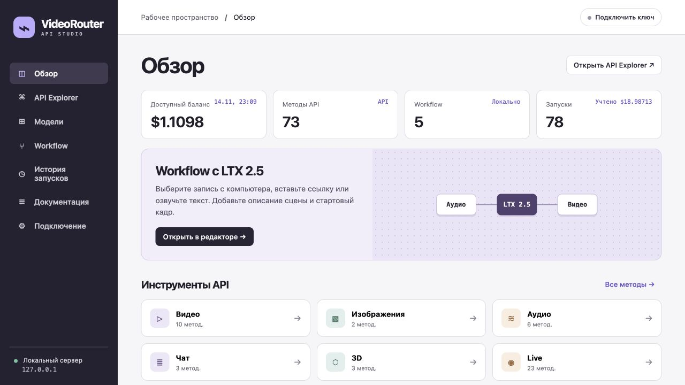

### 2. Workflow — функционален, перегружен по вертикали

Один шаг содержит длинную последовательность настроек; масштабирование на несколько шагов затруднено.

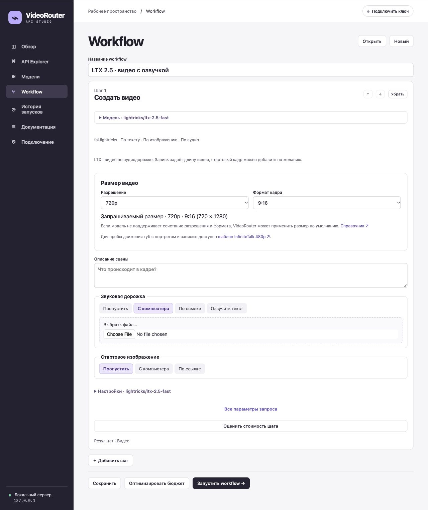

### 3. Расширенные параметры — нарушен контекст перехода

После перехода сохранена прокрутка предыдущего экрана, видна середина формы. Это зафиксированный landing state, не специально выбранная область формы.

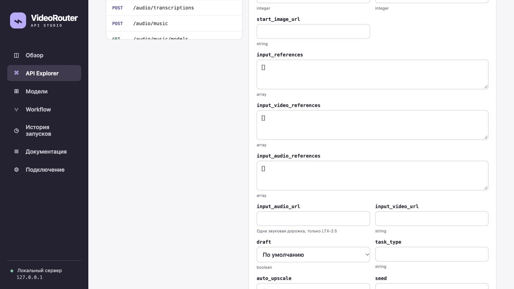

### 4. Оценка шага — понятный вход, неполная связь с запуском

Проверена локальная валидация длительности. Внешний расчёт не запускался; отсутствие исходного аудио в копии не является дефектом продукта.

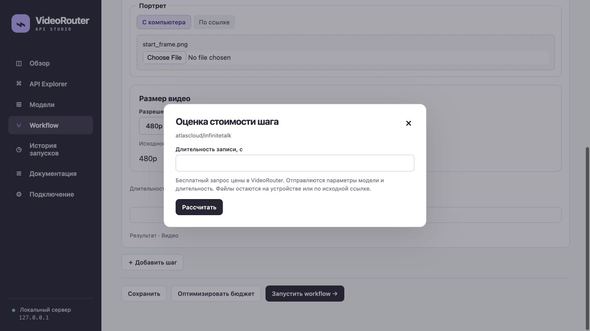

### 5. Бюджет — полезная основа, ограничения поиска нужно объяснять

Есть минимум/максимум и выбор участия шагов. Расчёты не запускались; ограничения установлены по коду.

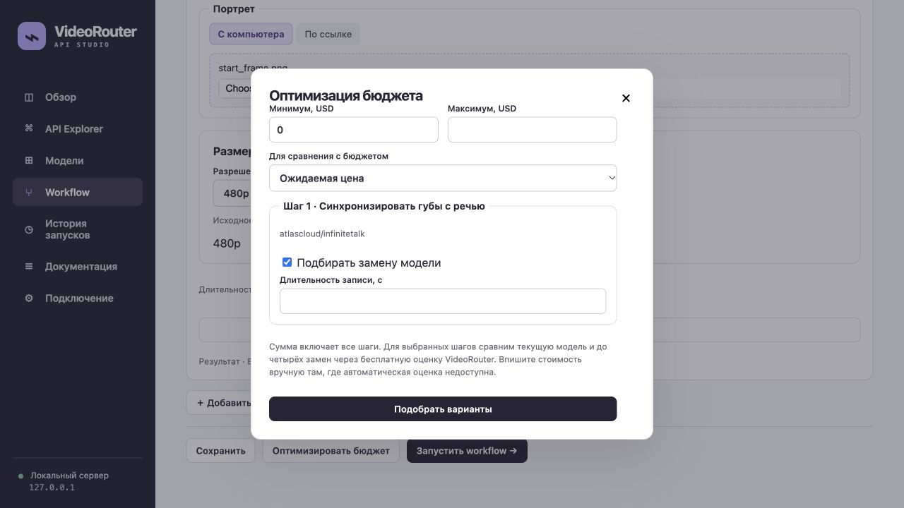

### 6. Модели — поиск и сортировка работают, выбор остаётся техническим

Тарифы видны, но не заменяют оценку конкретной конфигурации.

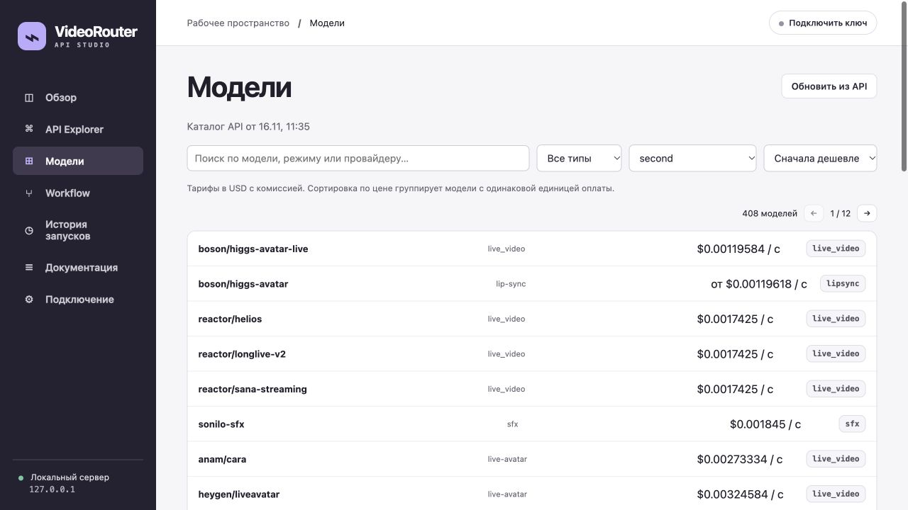

### 7. Ошибка — недостаточно помощи для исправления

Сохранённая ошибка обязательного voice выводится HTTP/JSON без исходной формы и перехода к полю. Это прошлый запуск из БД, не новый запрос аудита.

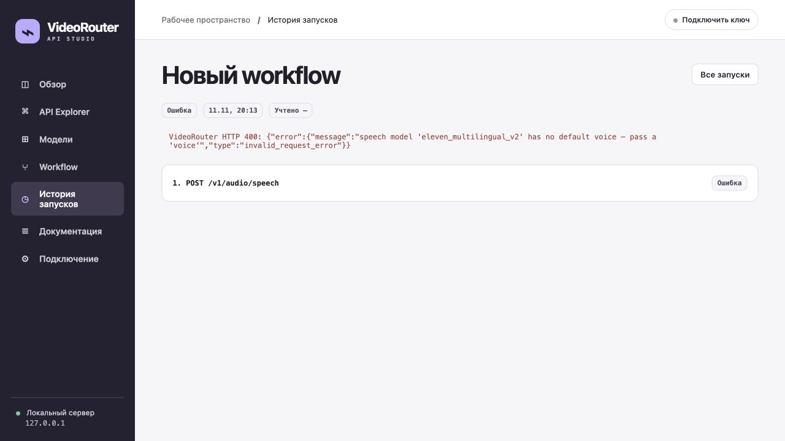

### 8. Телефон — базовая адаптация работает, навигация и длина формы затрудняют работу

Проверка ширины 390 px. Имя сохранённого файла соседствует с `No file chosen`. Проверка не подтверждает доступность через реальный Tailscale.

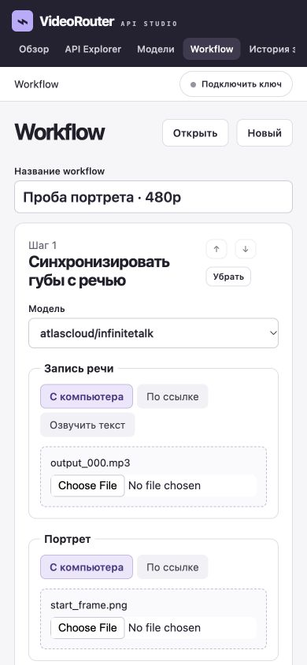

SHA-256 исходников на момент аудита: [source-hashes.json](evidence/source-hashes.json). Манифест относится к восьми файлам приложения до создания папки Handoff, не ко всему репозиторию или БД.

## B. Примеры пользователя — ориентир для нового workflow

Пользователь явно разрешил использовать принцип, не требует копирования стиля. Источник сайта и его фактическая реализация отдельно не проверялись. Это не снимки текущего локального продукта. Показанные модели, цены и наборы полей — визуальный контекст, не актуальный контракт API.

### R1. Image → Text to Image

Три режима Image, большой ввод, компактные параметры и цена рядом с действием.

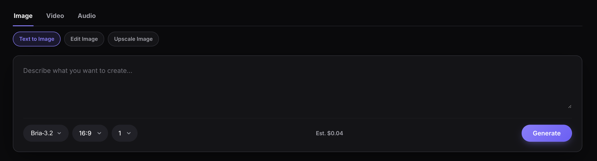

### R2. Image → Edit Image

При смене действия появляется вход для изображения/референса. Подсказка с `@` — наблюдаемая деталь примера, не автоматически обязательное требование нашего продукта.

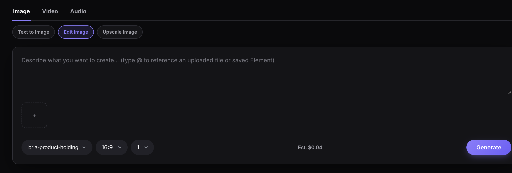

### R3. Video → Text to Video

Восемь действий: Text to Video, Image to Video, Reference to Video, Edit Video, Extend Video, Motion Control, Upscale Video, Lip Sync. Видны длительность, разрешение, количество и цена с fallback.

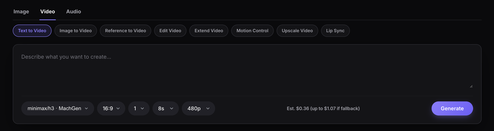

### R4. Video → Reference to Video

Тот же каркас формы с входом референсов. Для нашего workflow источник такого входа должен включать результат другого шага, не только ручное добавление файла.

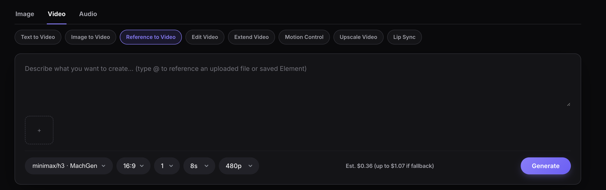

## C. Проверки после реализации

### 9. Компактная цепочка этапа 4

Пять шагов после reload; ширина 390 px, без горизонтального переполнения формы. Запуск проверялся на локальных фикстурах. Этот снимок сделан до исправления 08 и не подтверждает актуальные поля Image.

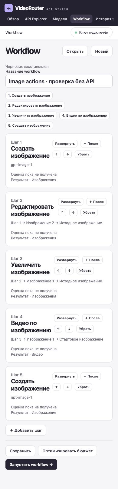

### 10. Исправленная предварительная цена изображения

Настоящая бесплатная оценка GPT Image 1 без prompt, 1024×1536 / medium: $0.064575 (в UI округлено). Проверена в изолированной версии с транспортом, разрешавшим только pricing/estimate. Это снимок конкретной проверки, не гарантия неизменной цены. Описание — [08](08-quote-model-format-fix.md).

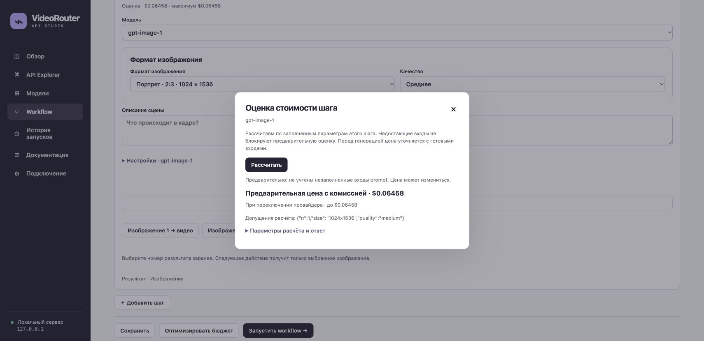

Фактический запуск server + Tailscale подтверждён отдельной CLI/HTTP-проверкой, не этим скриншотом. История и границы проверки — [09](09-current-state-and-next-thread.md).
